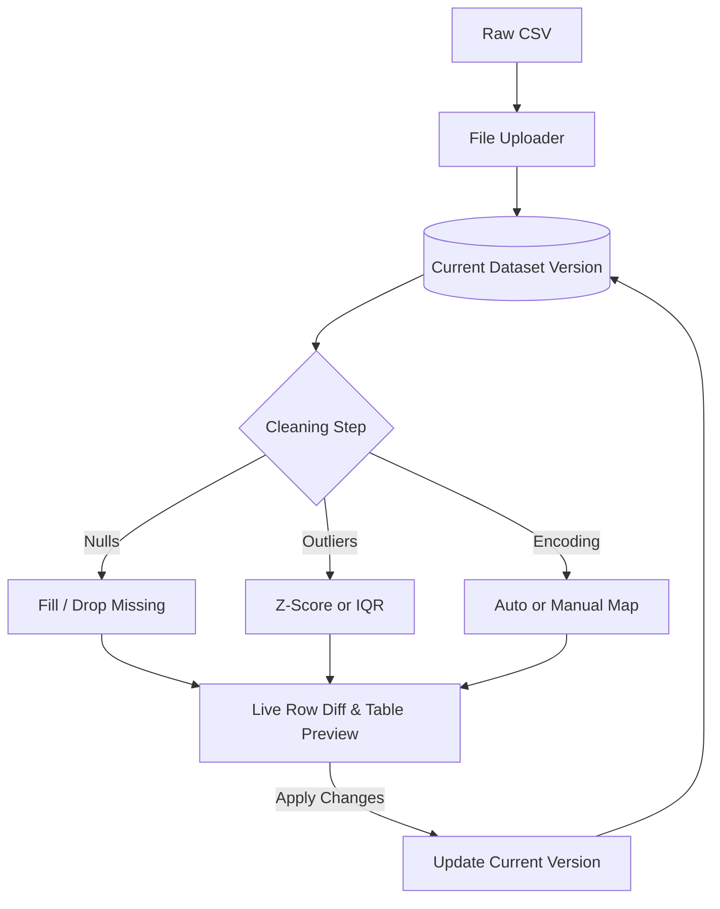
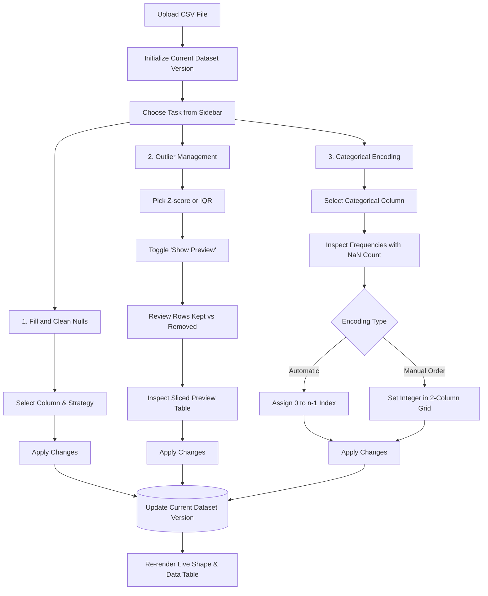

# DataLave — Tabular Data Cleaning & Preprocessing Suite

[](https://www.python.org/)
[](https://streamlit.io/)
[](https://pandas.pydata.org/)
[](https://numpy.org/)

DataLave is an interactive preprocessing interface for tabular datasets. Instead of writing one-off scripts for standard exploratory cleaning, DataLave provides a dedicated UI to audit distributions, impute missing values, filter statistical outliers, and map categorical features with live row-diff feedback before committing changes and more.

## Data Flow



## Core Capabilities

| Feature | What it handles | Technical details |
| --- | --- | --- |
| Missing values | Drops dirty rows or fills them | Runs `dropna(subset=[col])` or imputes via column `mean`, `median`, `min`, or `max`. |
| Parametric outliers | Filters normal distributions | Standard cutoffs at $\pm 1\sigma, \pm 2\sigma,$ or $\pm 3\sigma$ using column mean and standard deviation. |
| Non-parametric outliers | Handles skewed numeric features | Dynamic IQR fences ($Q_1 - k \cdot \text{IQR}$ to $Q_3 + k \cdot \text{IQR}$) controlled with a $0.0$ to $5.0$ multiplier slider. |
| Row diff preview | Sanity-checks filters before saving | Shows exact row drop counts (`len(old) - len(new)`) without mutating the active working data. |
| Category breakdown | Summarizes discrete values | Calls `value_counts(dropna=False)` so missing rows show up as their own category rather than vanishing. |
| Integer encoding | Preps categories for models | Supports automatic indexing ($0$ to $n-1$) or a 2-column manual input grid for custom ordinal hierarchies. |

## Technology Stack

| Area | Tools |
| --- | --- |
| Web interface | [](https://streamlit.io/) Wide layout, reactive state, column widgets |
| Data manipulation | [](https://pandas.pydata.org/) Series transformations, quantiles, mapping dictionaries |
| Calculations | [](https://numpy.org/) Vectorized filtering and boolean masking |

## Repository Structure

```text
DataLave/
├── DataLave.py          # Streamlit app and pipeline logic
├── requirements.txt     # Locked project dependencies
└── README.md            # Architecture specs and setup instructions
```

## Interactive Pipeline Workflow



### Transformation Module Breakdown

- **1. Fill and Clean Nulls:** Target a specific column to drop null records (`dropna(subset=[col])`) or fill missing positions using standard column metrics (`mean`, `median`, `min`, `max`).
- **2. Outlier Management:** 
  - **Z-Score:** Fast standard deviation cutoffs ($\pm 1\sigma, \pm 2\sigma, \pm 3\sigma$) for bell-curved features.
  - **IQR Score:** Multiplier slider ($k \in [0.0, 5.0]$) to set fences past $Q_1$ and $Q_3$.
  - **Live Preview:** Toggling **Show Preview** runs the calculation against an isolated DataFrame copy and displays the exact row reduction before you commit.
- **3. Encoding:** Renders category frequencies via `value_counts(dropna=False)`.
  - **Encode randomly:** Loops through unique items and assigns auto-incremented integers from $0$ to $n-1$.
  - **Encode in manual Order:** Builds an alternating two-column widget layout (`idx % 2`) with distinct keys (`manual_enc_{feature}_{idx}`) to assign ordinal values without UI ID collisions.

## State Management & Function Contract

The **Current Dataset Version** represents the single active source of truth. Modular transformation functions receive copies of the data, compute modifications, and return a clean DataFrame only when the user commits an action.

| Function | Signature | Notes |
| --- | --- | --- |
| `clean_data()` | `(df, feature, method)` | Returns DataFrame copy with selected feature imputed or pruned. |
| `Outliers()` | `(df, feature, methods1, submethods1, k)` | Slices DataFrame within numeric boundaries; returns filtered copy. |
| `Encode()` | `(df, feature, mapping_dict)` | Runs `.map(mapping_dict)` across selected column; returns encoded copy. |

## Local Setup & Installation

1. Set up a virtual environment:

   **Windows (PowerShell):**
   ```powershell
   py -m venv venv
   .\venv\Scripts\Activate.ps1
   ```

   **macOS / Linux:**
   ```bash
   python3 -m venv venv
   source venv/bin/activate
   ```

2. Install dependencies:

   ```bash
   python -m pip install --upgrade pip
   pip install -r requirements.txt
   ```

## Launching the App

```bash
streamlit run DataLave.py
```
## Notes to be taken

- Transformations run on isolated DataFrame copies (`df.copy()`) inside utility functions so dataset mutations remain predictable.
- Missing values in Module 3 are intentionally kept in the frequency view to avoid unhandled float conversion errors during encoding.
- Large CSV uploads may hit default file-size ceilings. Configure `server.maxUploadSize` in `.streamlit/config.toml` if you plan to process files larger than 200MB.
